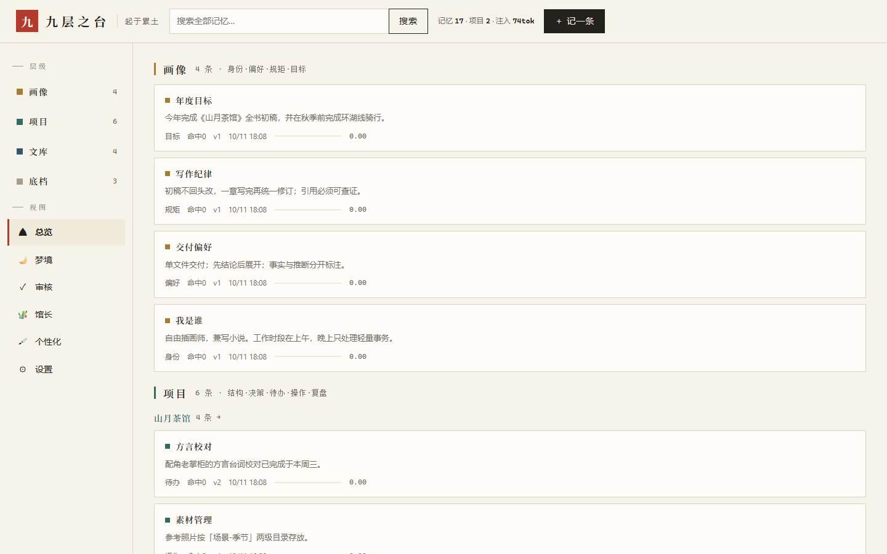
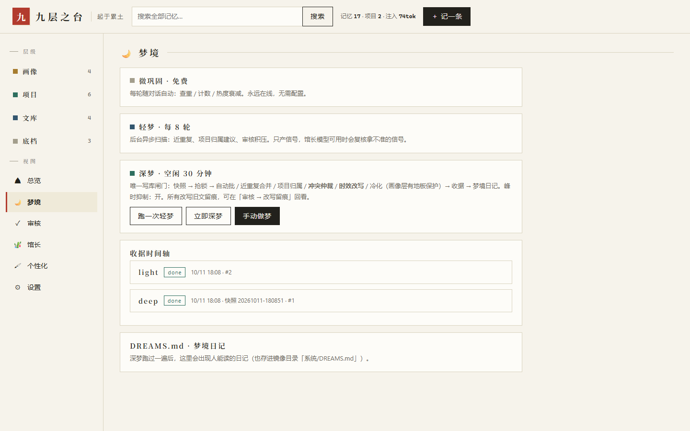
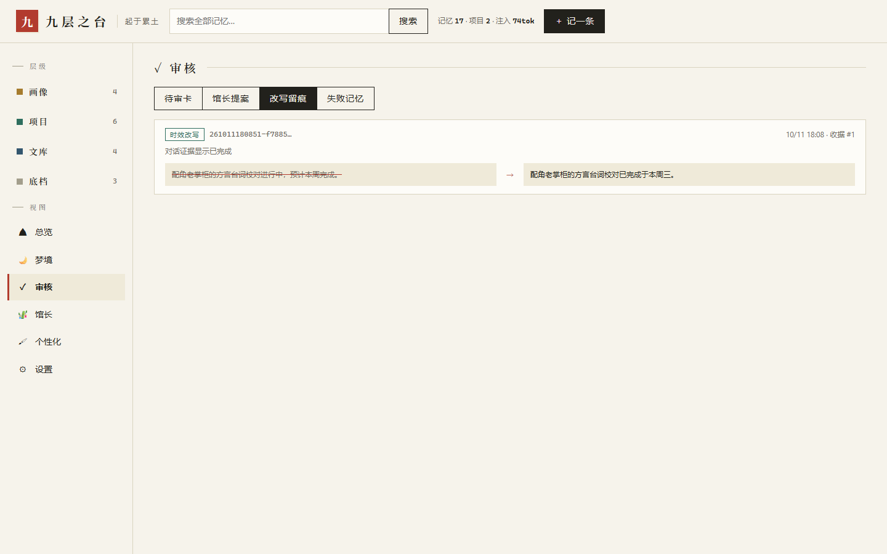
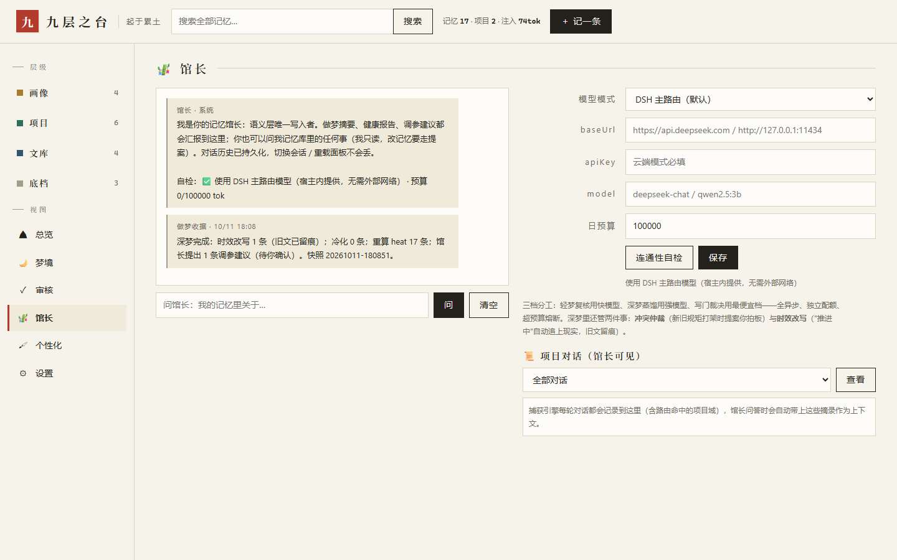

# 九层之台 · dsh-sandman

> 记不记，是门道；忘不忘，是功夫。
> 九层之台，起于累土。——《老子》

> [!WARNING]
> **预览版 · 娱乐性项目（Preview / For Fun）**
> 这是个人玩票性质的实验作品，不是生产级工具。用于探索「AI 记忆该长什么样」这个问题，代码与机制都还在快速变动中。
> - **请勿用于处理重要或敏感数据**，不做任何稳定性、兼容性、数据安全方面的承诺。
> - 会写库、会改配置、会调模型——**请在测试环境里玩**。
> - 接口与数据库 schema 可能随时变更，升级不保证向后兼容。
> - 欢迎提 issue 讨论思路，但对修复时效不作承诺。

DSH（DeepSeek Harness）桌面端的本地记忆插件：倒金字塔四层记忆 + 热度晋升 + 三档做梦 + 双决策门 + 记忆馆长。全部数据落在本地 SQLite，模型可用时增强、不可用时全系统按规则降级，**永不卡死、永不静默丢记忆**。

English summary: a local-first memory plugin for DeepSeek Harness — a four-tier inverse-pyramid memory store with heat-based promotion, three-tier "dreaming" (consolidation), JEV-style dual gating (write gate + project router), and a Curator agent (cloud API / local Ollama / DSH main route). MIT licensed. All data stays in local SQLite; every model-augmented step degrades gracefully to rules.

> **Preview / hobby project** — an experiment exploring what agent memory should look like, not a production tool. Don't point it at data you care about.

[](LICENSE)
[](CHANGELOG.md)

---

## 它能做什么

| 能力 | 说明 |
|---|---|
| **四层九位** | 画像（身份/偏好/规矩/目标）→ 项目（结构/决策/待办/操作/复盘）→ 文库（教训/提示词/规范/知识）→ 底档（流水）。顶层预算硬约束（默认 30 条 × 200 字），底层无限 |
| **捕获** | 监听对话自动提取候选记忆，写门三道（查重 → 相似度/冲突 → 馆长裁决），进审核队列，人工拍板 |
| **注入** | systemPrompt 分段注入：画像常驻 + 按路由项目装配 top-K + 个性化指令（全局/按工作区命中），契合度 <0.5 丢弃防跨项目污染 |
| **三档做梦** | 微巩固（每轮免费）/ 轻梦（每 N 轮，只产信号）/ 深梦（空闲 30 分钟，唯一写库闸门：快照→抢锁→整理→收据→日记） |
| **时效改写** | 深梦扫描"推进中/下周/截止"类记忆，馆长对照当前日期与近期对话证据判过期，自动改写时态，**旧文成对留痕**（审核页「改写留痕」可看 diff） |
| **冲突仲裁** | 新旧规矩打架时，馆长只产提案不执行——采纳后输家归档、全程留痕。审核制红线：模型永不静默改记忆 |
| **记忆馆长** | 独立管理面：问答（带 8 轮上下文 + 项目对话流水）、调参提案、三模式（DSH 主路由 / 云端 OpenAI 兼容 / 本地 Ollama）、日 token 预算熔断 |
| **可审计** | 每条记忆带版本链（memory_versions）+ 变更链（memory_changes）+ 做梦收据（可重放 input_hash）。永不物理删除 |

## 界面

现代主义中式面板（宣纸 · 墨 · 朱砂）：`http://127.0.0.1:<DSH 端口>/dsh-sandman/api/ui/panel`，或点 DSH 侧边栏左下角「九层之台」。

| 总览 | 梦境 | 审核 · 改写留痕 | 馆长 |
|---|---|---|---|
|  |  |  |  |

> 截图为全合成演示数据：`node scripts/make-demo-db.mjs` 可复现。

## 安装

**方式一：插件市场（推荐）**。在 DSH 插件市场搜索「九层之台」或 `dsh-sandman`，一键安装，重启生效。

**方式二：本地链接（开发）**。

```bash
git clone https://github.com/cwy-jun/dsh-sandman.git && cd dsh-sandman
npm install && npm run build
# Windows：把插件目录以 Junction 链进 profile（macOS/Linux 用 ln -s 绝对路径）
New-Item -ItemType Junction -Path "<DSH_HOME>\profiles\desktop\node_modules\dsh-sandman" -Target "<本仓库绝对路径>"
# profile 的 package.json：dependencies 加 "dsh-sandman": "link:<本仓库绝对路径>"，dsh.profile.bundles 加 "dsh-sandman"
```

重启 DSH 后，在「设置 → 插件 → dsh-sandman」调参；面板入口在侧边栏头像上方。

## 配置速览（设置页全部可改）

| 键 | 默认 | 含义 |
|---|---|---|
| `captureEnabled` / `captureMinChars` | 开 / 200 | 自动捕获开关 / 一轮最短字数 |
| `injectEnabled` | 关 | 记忆注入总开关（与其他记忆插件并用时先关） |
| `lightEveryTurns` / `deepIdleMinutes` | 8 / 30 | 轻梦间隔 / 深梦空闲阈值 |
| `peakSuppress` + `peakWindows` | 开 / 09–12·14–18 | 峰时抑制（对齐 API 峰谷时段） |
| `staleDays` / `staleHeatMax` | 30 / 0.05 | 冷化标准（画像层有地板保护，只走改写不走冷化） |
| `promoteHeat` | 0.5 | 底档晋升文库的 heat 阈值（提案制） |
| `curator.mode` | dsh | 馆长模型：dsh / cloud / local |
| `dailyTokenBudget` | 100000 | 馆长日 token 熔断 |

## 架构

```
对话流 ──▶ 捕获引擎 ──写门(查重/相似/馆长)──▶ 审核队列 ──▶ 四层库(SQLite + FTS5)
                 │                                     ▲   ├─ memory_versions 版本链
注入 ◀──systemPrompt 分段(画像常驻+项目top-K+个性化)───┘   └─ memory_changes  变更链
做梦引擎：微巩固(每轮) / 轻梦(信号) / 深梦(快照→锁→整理→收据→DREAMS.md)
馆长：问答 / 时效改写 / 冲突仲裁 / 调参提案（三模式 + 日预算熔断，失败全降级规则）
```

```
src/
├─ index.ts     # 薄入口：cordis 注册 + 装配
├─ core/        # 纯函数零依赖：schema(迁移链) / heat(晋升公式) / bm25(CJK bigram) / gating(写门) / router(路由)
├─ services/    # capture / dreamer(三档+锁) / curator(馆长) / inject(注入)
├─ store/       # node:sqlite(WAL+租约锁) + Markdown 镜像 + 快照导出
└─ ui/          # api.ts + panel.html 单文件面板（hash 路由，零依赖）
```

技术要点：`node:sqlite`（Node ≥ 22.5）；FTS5 bigram 中文检索；esbuild 单文件打包；面板单文件零外链。数据落点 `<DSH_HOME>/storages/dsh-sandman/` + `memory-vault-sandman/`（人能直接看的 Markdown 镜像）。

## 开发

```bash
npm install
npm run build       # lib/ 单文件 + .testbuild/ 逐文件转译（测试用）
npm test            # 57 项：core / M2-M6 / API / 锁 / 馆长对话 / 个性化 / v4 机制
npm run typecheck
node scripts/make-demo-db.mjs                       # 合成演示库（无任何真实数据）
SANDMAN_DB=<库路径> node scripts/preview-panel.mjs  # 面板本地预览（只读副本，Ctrl+C 退出）
```

## 设计红线

1. 永不物理删除——失效、归档、留痕，都是状态。
2. 模型失败降级规则，规则再失败转人审，绝不静默。
3. 语义写入唯一闸门是深梦；馆长改记忆必须走提案/留痕。
4. 画像层不被时间冷化误杀（地板保护），过期事实走"改写"而非"遗忘"。

## 机制来源致谢

设计参考了公开的记忆系统工作：mem0（ADD-only 时间元数据）、Letta/MemGPT（sleep-time compute 与主对话解耦）、MemPalace（结构过滤优先于向量 + 原文直存）、OpenViking（分层加载，AGPL，本项目未搬移其代码）、Zep/Graphiti（事实有效期窗口）、OpenAI Dreaming（时效自改写）、REALM（检索驱动再巩固）与 Microsoft 人脑启发六机制（干扰性遗忘/地板保护）。实现与代码为本项目原创。

## License

MIT（见 [LICENSE](LICENSE)）
